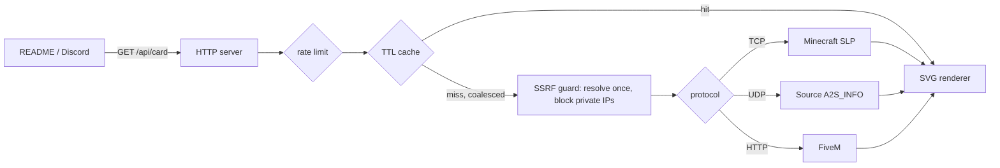

<div align="center">

# gameserver-card

**Live, animated SVG status cards for game servers. Drop one into a README, website or Discord.**

[](https://github.com/TurhanSarimsak/gameserver-card/actions/workflows/ci.yml)


</div>

Supports **Minecraft Java**, every **Source engine** game (CS2, TF2, Rust, Garry's Mod, ARK, Left 4 Dead…) and **FiveM / RedM**.
Every protocol is implemented by hand on top of raw TCP/UDP sockets. There are **zero runtime dependencies**.

<p align="center">
  
  
</p>

## Usage

```md

```

| Endpoint | Returns |
| --- | --- |
| `GET /api/card` | Animated SVG card |
| `GET /api/status` | Raw status as JSON |
| `GET /api/shields` | [shields.io endpoint](https://shields.io/badges/endpoint-badge) JSON. Use it as `https://img.shields.io/endpoint?url=…` |
| `GET /` | Interactive card builder with live preview |

| Parameter | Default | Description |
| --- | --- | --- |
| `game` | `minecraft` | `minecraft`, `source` or `fivem` |
| `host` | required | Hostname or IP |
| `port` | per game | `25565`, `27015`, `30120`. Minecraft also resolves `_minecraft._tcp` SRV records |
| `theme` | `dark` | `dark`, `light`, `dracula`, `nord`, `tokyonight`, `synthwave` |
| `title` | server name | Custom title |
| `hide_border` | `false` | Remove the card border |
| `animate` | `true` | Set to `false` to disable animations (also respects `prefers-reduced-motion`) |

### Themes

| | |
| :-: | :-: |
|  `dark` |  `light` |
|  `dracula` |  `nord` |
|  `tokyonight` |  `synthwave` |

## How it works



### Protocols

**Minecraft: Server List Ping** ([spec](https://minecraft.wiki/w/Java_Edition_protocol/Server_List_Ping))
Every packet is framed as `VarInt length | VarInt id | data`. The client sends a *Handshake* with protocol version `-1` (meaning "tell me what you run") and `nextState = 1`, followed by a *Status Request*. The server replies with a JSON document containing the version, player counts, MOTD (a nested chat component) and a base64 favicon. A final *Ping/Pong* exchange measures round-trip latency. TCP is a stream, so packets can arrive split or glued together. [`readPackets`](src/protocols/minecraft.ts) reassembles them.

**Source engine: A2S_INFO** ([spec](https://developer.valvesoftware.com/wiki/Server_queries#A2S_INFO))
This is a single UDP datagram: `FF FF FF FF 54 "Source Engine Query\0"`. Since 2020, servers answer with an `S2C_CHALLENGE (0x41)` first, which the client must echo back to prove it isn't spoofing its source IP (an anti-amplification measure). The `0x49` reply is a packed little-endian struct of null-terminated strings and bytes, parsed with a bounds-checked cursor.

**FiveM:** `GET /dynamic.json` over HTTP, with Cfx `^1` colour codes stripped.

### Security

A service that connects to *any host a user types in* is a classic **SSRF** vector. Without protection, `?host=169.254.169.254` would probe your cloud metadata API and `?host=10.0.0.5` would scan your private network.

- Every hostname is resolved **once**. The IP is checked against loopback, private, link-local, CGNAT, multicast and reserved ranges (IPv4, IPv6 and IPv4-mapped IPv6) using `net.BlockList`.
- The socket then connects to **that exact IP**, so a second DNS lookup can't swap in a private address (**DNS rebinding**).
- HTTP redirects are refused, so a redirect can't point the request at an internal URL.
- All user text in the SVG is XML-escaped, favicons must match a strict `data:image/png;base64` pattern, and SVG responses ship with a restrictive `Content-Security-Policy`.

### Performance

- **TTL cache with request coalescing.** When 1,000 READMEs ask about the same server at once, exactly **one** query goes out and every request awaits the same promise.
- **Token-bucket rate limiting** per client IP.
- `Cache-Control` with `stale-while-revalidate`, so GitHub's image proxy (camo) and CDNs absorb most traffic.

## Self-hosting

```bash
git clone https://github.com/TurhanSarimsak/gameserver-card
cd gameserver-card
npm install && npm run build
npm start            # http://localhost:3000
```

Or with Docker:

```bash
docker build -t gameserver-card .
docker run -p 3000:3000 gameserver-card
```

| Env var | Default | |
| --- | --- | --- |
| `PORT` | `3000` | |
| `CACHE_TTL_SECONDS` | `60` | How long a status is cached |
| `QUERY_TIMEOUT_MS` | `3000` | Per-server query timeout |
| `RATE_LIMIT_PER_MINUTE` | `60` | Requests per client IP |
| `TRUST_PROXY` | `false` | Use `X-Forwarded-For` for client IPs (enable behind a reverse proxy) |
| `ALLOW_PRIVATE_HOSTS` | `false` | Allow LAN/loopback targets. **Only for private deployments** |

## Development

```bash
npm run dev         # watch mode, runs TypeScript directly (Node type stripping)
npm test            # node:test, with mock Minecraft (TCP) and Source (UDP) servers
npm run typecheck
npm run examples    # regenerate docs/examples/*.svg
```

The tests spin up real in-process TCP and UDP servers that speak each protocol, covering challenge handling, fragmented packets, timeouts, SSRF blocking, XSS escaping and cache coalescing.

## License

[MIT](LICENSE) © Turhan Sarımsak
